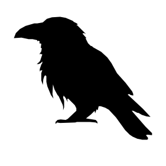
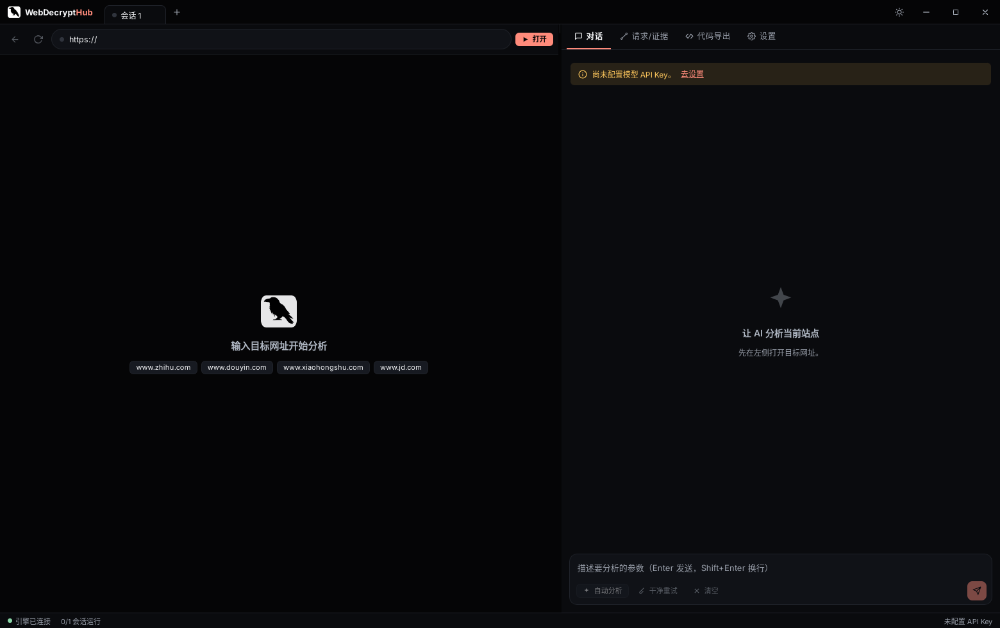
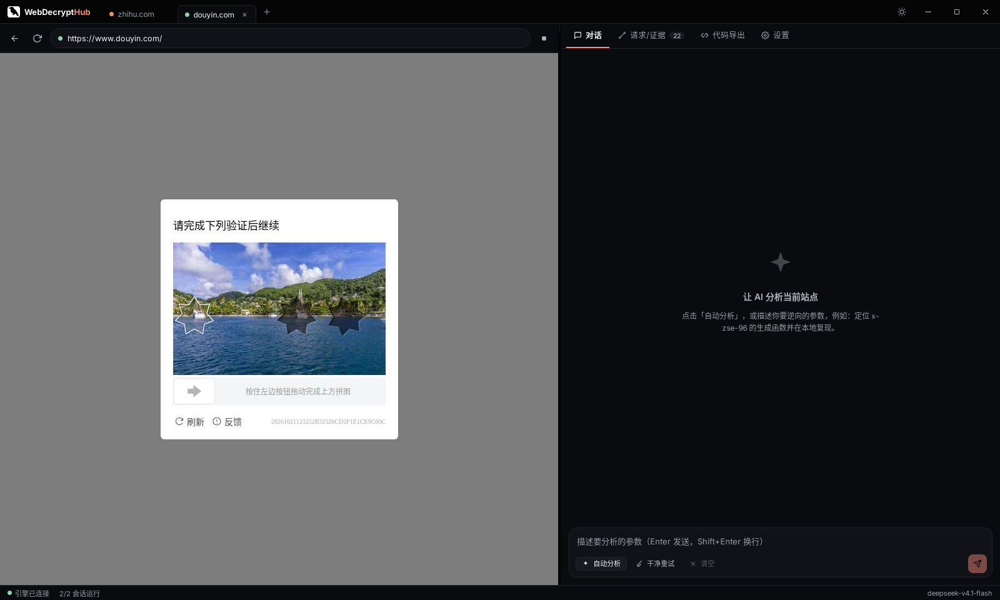
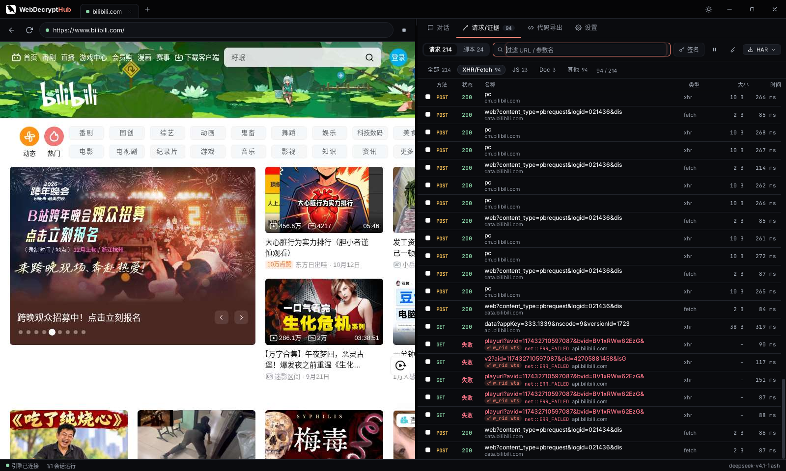
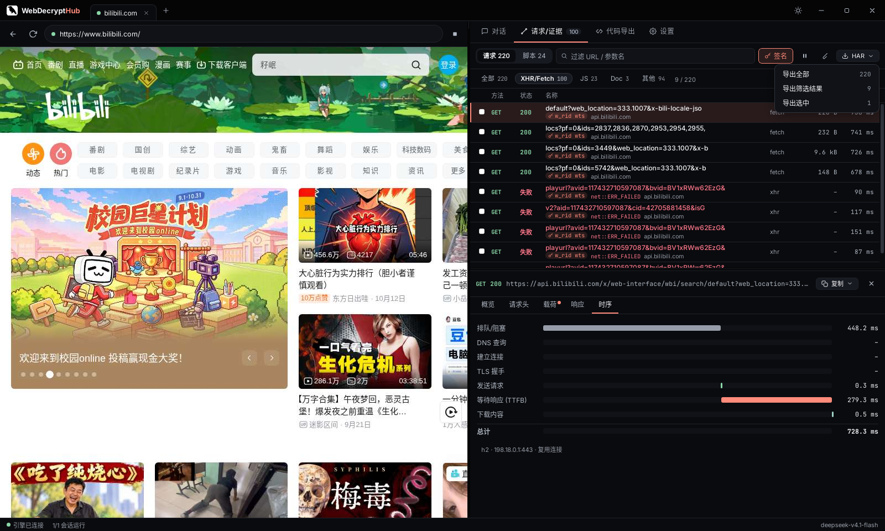
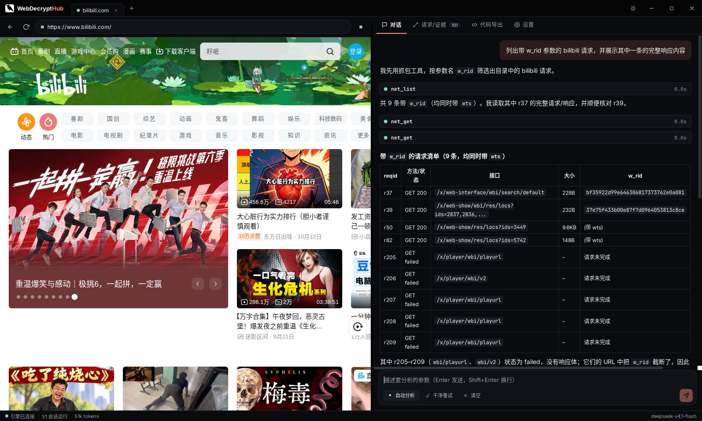

<p align="center">
  
</p>

# WebDecryptHub

**中文 | [English](#english)**

面向授权安全研究的桌面端 JS 逆向工作台：无边框 Tauri 界面 + Node sidecar + Patchright/CDP，集成网络抓包（HAR）、反调试、指纹追踪、AST 反混淆、VMP 轨迹与 AI Agent。

> **免责声明 / Disclaimer**  
> 本项目仅供学习与**已获授权**的安全研究使用。请遵守当地法律法规与目标站点服务条款。作者不对滥用行为负责。

官网 / Website: [https://ios.decrypthub.com/](https://ios.decrypthub.com/)

## 截图

| 空会话 | 多会话 | 网络面板 |
|--------|--------|----------|
|  |  |  |

| HAR 导出 | AI 对话 |
|----------|---------|
|  |  |

## 功能

- **浏览器控制**：有头/无头、视口跟随、反调试注入（导航后仍保持）、指纹采集点追踪
- **网络 / 证据**：CDP 抓包、签名高亮、复制 cURL / Python、HAR 1.2 导出
- **AI Agent**：OpenAI 兼容 API（可配置 `baseUrl` / model / key），工具调用驱动分析
- **工作区**：每会话独立目录，`workspace_run` / `workspace_npm`（Windows 安装包捆绑 Node）
- **AST / VMP / 补环境**：`ast_deobfuscate`（运行时等价检查）、`vmp_trace_*`、`env_iterate`
- **在线更新**：通过 GitHub Releases（`latest.json`）检查/安装更新

## 架构

```
+-------------------+     WebSocket      +------------------+
|  Tauri 2 (UI)     | <----------------> |  jsra-sidecar    |
|  React + Vite     |   keyring/native   |  Bun/Node + CDP  |
+---------+---------+                    |  Patchright      |
          | updater                      +--------+---------+
          v                                       v
   GitHub Releases                           Chromium
```

## 快速开始

### 使用安装包（Windows）

1. 从 [Releases](https://github.com/decrypthub/WebDecryptHub/releases) 下载 `WebDecryptHub-*-win-x64-setup.exe`
2. 安装后启动，在「设置」中配置 AI：`baseUrl`、`model`、`API Key`（可用环境变量思路：勿把密钥写进仓库）
3. 新建会话 → 启动浏览器 → 开始分析

### 从源码构建

**依赖**：Node 20+、Bun、Rust stable；Linux 需 WebKitGTK；Windows 需 WebView2。

```bash
# UI
npm ci
npm run build:ui

# Sidecar
cd sidecar && npm ci --ignore-scripts && cd ..  # isolated-vm uses prebuilds; full rebuild may fail on some Node ABIs
bun scripts/build-sidecar.mjs linux   # or: win

# Desktop (dev)
cargo run --manifest-path src-tauri/Cargo.toml

# Linux check
cargo check --manifest-path src-tauri/Cargo.toml
```

Windows 正式安装包由 GitHub Actions 在推送 `v*` 标签时构建（见 `.github/workflows/release.yml`）。

### AI 提供商

在设置中选择 OpenAI 兼容端点，例如：

- `baseUrl`: `https://api.openai.com/v1`（或你的网关）
- `model`: 任意 chat completions 模型名
- `apiKey`: 仅保存在系统凭据库 / 本地，**不要提交到 Git**

也可在开发时用环境变量注入密钥到测试脚本，应用本身通过设置页与 keyring 读取。

### 自动更新

应用会在启动后静默检查  
`https://github.com/decrypthub/WebDecryptHub/releases/latest/download/latest.json`  
也可在「设置 → 软件更新」手动检查、查看说明并安装重启。  
签名公钥嵌入 `src-tauri/tauri.conf.json`；私钥仅存在于发布 CI 的 Secrets。

## 许可证

- 本仓库源码：**MIT**（见 [LICENSE](./LICENSE)）
- 内置 `sidecar/vendor/core-build`（js-reverse-mcp）：**Apache-2.0**（见该目录 `LICENSE` / `NOTICE`）
- 其他依赖见 [THIRD_PARTY_NOTICES.md](./THIRD_PARTY_NOTICES.md)

---

<a id="english"></a>

## English

WebDecryptHub is a desktop JS reverse-engineering workbench for **authorized** security research: frameless Tauri UI, Node sidecar, Patchright/CDP, network/HAR capture, anti-debug & fingerprint hooks, AST/VMP tooling, and an OpenAI-compatible AI agent.

**Disclaimer:** For learning and authorized research only. Comply with applicable law and site Terms of Service.

- Site: [https://ios.decrypthub.com/](https://ios.decrypthub.com/)
- Screenshots: see `docs/screenshots/`
- Build: Node 20 + Bun + Rust; `npm ci && npm run build:ui`, `bun scripts/build-sidecar.mjs`, `cargo run --manifest-path src-tauri/Cargo.toml`
- Updates: GitHub Releases `latest.json` via `tauri-plugin-updater`
- License: MIT (vendored js-reverse-mcp remains Apache-2.0)

