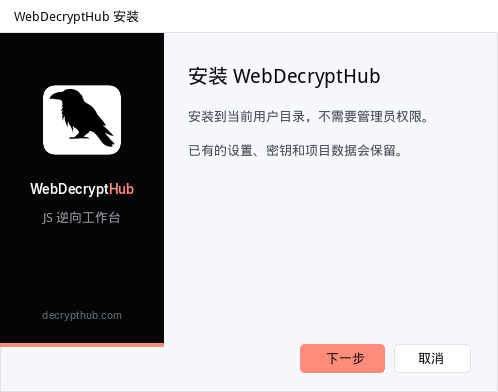
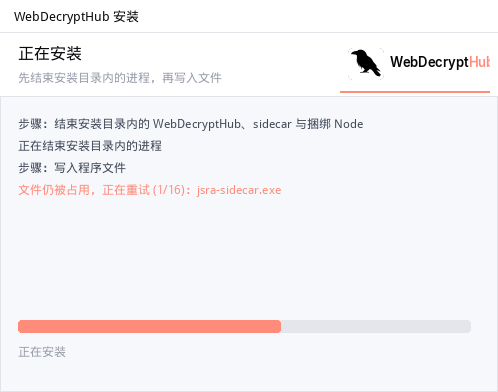
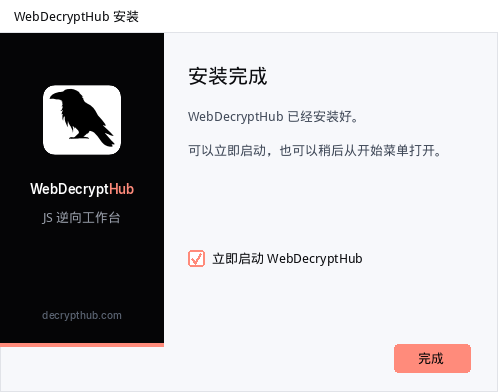

## WebDecryptHub 1.3.1

### 安全模式的「本会话始终允许」只在本次运行有效
- 选「本会话始终允许」之后，这一次打开应用期间同类操作不再询问。
- 这个选择不再写入 `<项目>/.agent-state.json`，重启应用后会重新询问。

### 应用内更新不再卡在文件占用
- 设置里检查更新后，会先看到下载百分比，接着是「正在安装」。
- 安装程序启动前，应用会先让侧车自己关掉浏览器、工作区后台任务和捆绑的 Node，等它退出；超时后再强制结束这棵进程树。
- 侧车退出之后才拉起安装程序并退出应用。安装完成会自动重新打开。
- 关掉浏览器时，只有关闭超过 8 秒仍未结束，并且该 PID 的映像和用户数据目录仍是这次启动的 Chrome，才会强制结束那棵进程树。Chrome 已经退出后不再按 PID 结束，避免误伤后来复用这个 PID 的程序。

### 安装程序自己也会等文件解锁
- 手动安装和更新用的静默/被动安装走同一套逻辑。
- 复制文件之前，只结束安装目录里的 `WebDecryptHub.exe`、`jsra-sidecar.exe` 和捆绑的 `node.exe`。路径必须在安装目录内，不会动你自己的 Chrome 或其他 Node。
- 文件仍被占用时会先重试大约八秒，之后才出现原来的错误提示。

### 安装界面
- 安装程序仍是当前用户安装（`AppData\Local\WebDecryptHub`）。页眉、侧栏和图标使用产品标志：墨色、珊瑚色和白色，没有渐变。
- 安装页会写明当前步骤。完成页默认勾选「立即启动 WebDecryptHub」。

